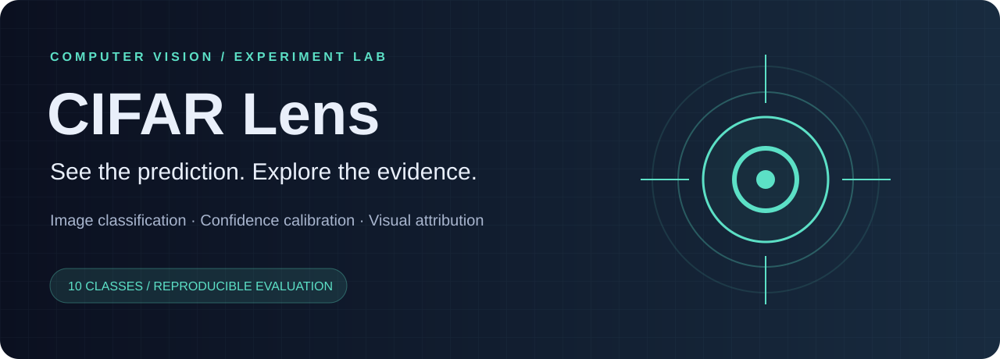

# ◉ CIFAR Lens



### See the prediction. Explore the evidence.

An interactive computer-vision lab built from a university CIFAR-10 CNN project. Upload an image, inspect ten class scores, explore Grad-CAM, and investigate confident mistakes.

**TensorFlow · Streamlit · reproducible experiments · calibration · model interpretability**

## Why this project exists

A model score alone tells little about how a classifier behaves. CIFAR Lens connects predictions to evaluation evidence: per-class performance, model confidence, visual attribution, and error examples. It also fixes the original experiment's test/validation overlap.

## Run locally

Use Python 3.12. Windows CPU is supported; for GPU training use a compatible Linux/WSL or Colab TensorFlow environment.

```bash
python -m venv .venv
# Windows: .venv\Scripts\activate
# macOS/Linux: source .venv/bin/activate
python -m pip install -r requirements.txt
python -m streamlit run app.py
```

The dashboard opens without weights and shows historical evidence. Live inference requires a trained experiment. No scores, predictions, heatmaps or benchmark improvements are fabricated.

```bash
# Quick pipeline check; not an accuracy benchmark
python -m lens.train --epochs 1 --limit 1000 --output artifacts/smoke

# Full experiments under the same protocol
python -m lens.train --architecture baseline --epochs 50 --output artifacts/baseline
python -m lens.train --architecture residual --epochs 50 --output artifacts/residual
python -m pytest -q
```

Training downloads CIFAR-10 on first use. On modest hardware, start with batch size 64. Each experiment directory must be empty to prevent accidental overwrites. Training writes model.keras, results.json, epochs.csv and errors.npz. Keep weights out of ordinary Git commits; distribute trained weights through release assets.

## Features

- Image upload, ten-class scores and downloadable prediction records
- Grad-CAM visual attribution computed from the active model
- Validation-fitted temperature scaling and confidence review control
- Training curves, confusion matrix, per-class metrics and reliability plot
- Explorer for the model's most confident test errors
- Seeded stratified split, separate final test evaluation and model checksum
- Smaller baseline and residual CNN with a consistent evaluation protocol
- Tests and GitHub Actions workflow

## Results and honest comparison

| Experiment | Accuracy | Macro F1 | Status |
|---|---:|---:|---|
| Original supplied notebook | 85.07% | 0.8488 | Historical; test set also used for validation |
| New baseline | Pending full training | Pending | No performance claim |
| New residual CNN | Pending full training | Pending | No performance claim |

A higher score is not promised. Full experiments need to establish whether the residual architecture improves on the new baseline. Comparison with the old score is limited by the changed evaluation protocol.

## Structure

```text
app.py              Interactive lab
lens/               Data, models, training, metrics and Grad-CAM
notebooks/          Clean walkthrough and historical group notebook
artifacts/          Local experiment outputs (ignored by Git)
evidence/           Extracted historical results and original figures
docs/               Model card, provenance and demo guide
tests/              Data integrity, numeric and model integration tests
```

## Attribution and AI assistance

Original CIFAR-10 assignment by **Rory O'Brien, Amir Hamza and MD Suyaib Rahman**, COIT12213, 2025. Group ownership is preserved; individual contribution claims are not invented. The starter notebook was supplied for the course. The original historical notebook's AI declaration describes that original submission only.

The portfolio extension was developed with OpenAI Codex assistance for design, refactoring, new code, tests and documentation. New work must not be described as written without AI assistance. The original notebook is retained with student IDs removed for public sharing; its technical cells and stored results are preserved. Source course documents and the unrelated insurance report are not redistributed in this package.

No license is assigned to the original group work without the contributors' agreement. See [provenance](docs/PROVENANCE.md) before publishing.

## Technical references

- [TensorFlow training and evaluation](https://www.tensorflow.org/guide/keras/training_with_built_in_methods)
- [Keras Grad-CAM example](https://keras.io/examples/vision/grad_cam/)
- [Streamlit resource caching](https://docs.streamlit.io/develop/concepts/architecture/caching)
- [CIFAR-10 dataset](https://www.cs.toronto.edu/~kriz/cifar.html)

See [model card](docs/MODEL_CARD.md) and [demo guide](docs/DEMO.md).
