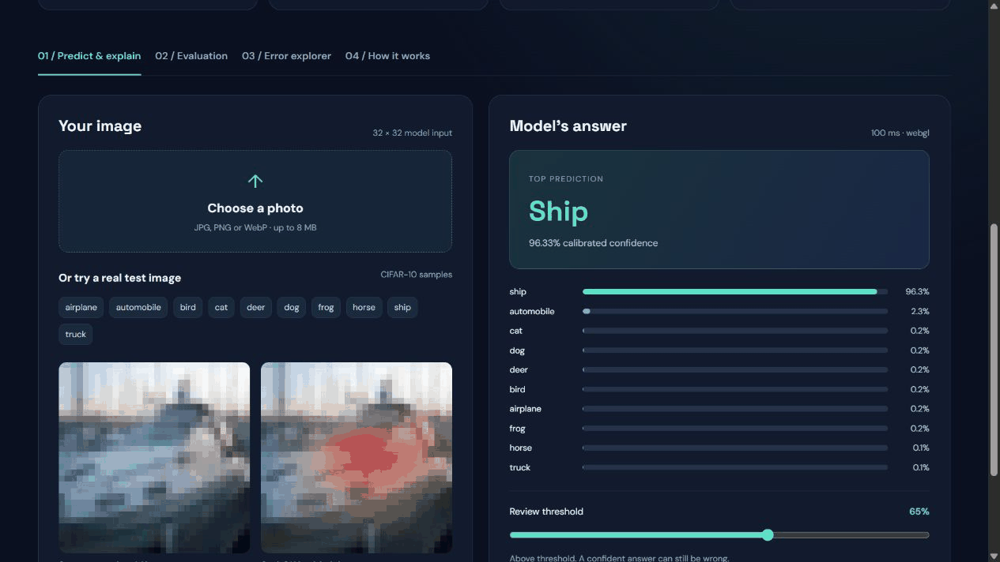
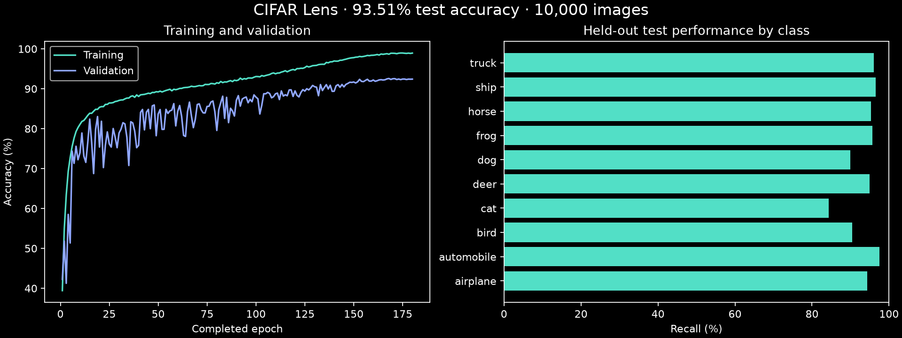

# ◉ CIFAR Lens

**[Open the live browser demo ↗](https://huggingface.co/spaces/AMIRHAMZAAAA4/cifar-lens)** · [Download the trained model](https://github.com/amirhamzaaaa4/cifar-lens/releases/tag/v1.0.0)


[](https://github.com/amirhamzaaaa4/cifar-lens/actions/workflows/tests.yml)
[](https://colab.research.google.com/github/amirhamzaaaa4/cifar-lens/blob/main/notebooks/Train_on_Colab.ipynb)

### See the prediction. Explore the evidence.

An interactive computer-vision lab for CIFAR-10. Upload a photo and see all ten class scores, a Grad-CAM heatmap of the regions behind the prediction, calibrated confidence, and the model's most confident mistakes. It also includes a reproducible training pipeline whose test set is never used for model selection.

**TensorFlow / Keras · Streamlit · Grad-CAM · calibration · reproducible experiments**

**Measured test accuracy: 93.51%** on 10,000 held-out CIFAR-10 images. The 95% bootstrap interval is 93.03%–93.98%. The live demo runs the verified model directly in your browser; uploaded photos stay on your device.





## Results

All new models are trained on 45,000 images, selected on a separate 5,000-image validation split, and evaluated once on the official 10,000-image test set.

| Model | Test accuracy (95% CI) | Macro F1 | Calibration error (ECE) | Parameters |
|---|---:|---:|---:|---:|
| Original notebook (2025) | 85.07%\* | 0.849 | — | — |
| ResNet20 + Cutout + label smoothing + flip TTA | 93.51% (93.03%–93.98%) | 0.9350 | 0.0141 | 274,042 |

\* The original notebook also used the test set for validation, so its score is optimistic and not directly comparable.

The completed ResNet20 run used all 180 planned epochs and has `smoke_run: false`. [Full evaluation record](evidence/trained/results.json). Separate reference experiments and additional seeds can be compared with `lens.compare`.

## What makes it different

- **Clean evaluation:** seeded stratified train/validation split. Early stopping, checkpoint choice and temperature calibration only ever see validation data.
- **Uncertainty you can check:** temperature scaling, a reliability plot, expected calibration error, and a bootstrap 95% confidence interval on test accuracy.
- **Explanations with caveats:** Grad-CAM from the live model, plus an error explorer showing the most confident mistakes for every class.
- **Reproducible runs:** every experiment records its seed, split sizes, recipe, library versions, hardware and a SHA-256 of the saved model. Interrupted runs resume safely, and multi-seed runs are compared as mean ± std.
- **Tested:** data-integrity, numerical, model, packaging and dashboard tests run in GitHub Actions.

## Run the app

Use Python 3.12.

```bash
python -m venv .venv
# Windows: .venv\Scripts\activate    macOS/Linux: source .venv/bin/activate
python -m pip install -r requirements-dev.txt
python -m streamlit run app.py
```

The dashboard opens without a trained model and shows the historical results. To get live predictions, train an experiment or download a published one:

```bash
python -m lens.fetch <release-zip-url> --output artifacts/resnet20
```

## Train

For GPU training, use the [Colab notebook](notebooks/Train_on_Colab.ipynb). It can save checkpoints to Google Drive when you choose to mount it; otherwise checkpoints remain in the temporary runtime.

```bash
# Short pipeline check (not a benchmark)
python -m lens.train --epochs 1 --limit 1000 --output artifacts/smoke

# Candidate recipe: ResNet20 on a GPU; runtime depends on available hardware
python -m lens.train --architecture resnet20 --epochs 180 --label-smoothing 0.1 --cutout 8 \
    --tta --mixed-precision --seed 73 --output artifacts/resnet20-s73

# Reference models
python -m lens.train --architecture baseline --epochs 50 --output artifacts/baseline
python -m lens.train --architecture residual --epochs 50 --output artifacts/residual

# Resume an interrupted run (same settings + --resume)
python -m lens.train --architecture resnet20 --epochs 180 --label-smoothing 0.1 --cutout 8 \
    --tta --mixed-precision --seed 73 --output artifacts/resnet20-s73 --resume

# Compare (repeat the ResNet20 run with --seed 1 and --seed 2 for mean ± std)
python -m lens.compare artifacts/baseline artifacts/residual artifacts/resnet20-s*
python -m pytest -q
```

Each run writes `model.keras`, `results.json`, `epochs.csv`, `errors.npz` and sample images to its own folder. Folders must be empty to prevent overwrites. Python model weights and checkpoints are distributed through GitHub Releases. The compact browser weights are included in `web/` with a verified checksum.

## Deploy

The public demo is a free [Hugging Face static Space](https://huggingface.co/spaces/AMIRHAMZAAAA4/cifar-lens). The `web/` folder contains its complete source and 1.1 MB of model weights. Uploaded images are centre-cropped, resized to 32×32 and normalized; browser canvas resizing can differ slightly from Python bicubic for photos. Identical CIFAR-10 pixels were checked against Python: **30/30 class matches**, maximum calibrated-score difference **2.38 × 10⁻⁷**. The app checks this comparison and the weights checksum on startup. Grad-CAM uses the exact formula for the model’s global-average-pooling and linear head. [Verification screenshot](evidence/trained/browser-parity.jpg).

For the full Python Streamlit app, Hugging Face Spaces (Docker) or any container host: build the included `Dockerfile` and set `LENS_EXPERIMENT_URL` to your release zip. The app downloads it on startup and verifies the model checksum. See [hosting notes](docs/HOSTING.md).

## Project structure

```text
app.py              Streamlit lab
lens/model.py       Baseline, residual CNN and ResNet20
lens/augment.py     Training-only pad-crop-flip and Cutout
lens/train.py       Reproducible training, calibration and evaluation
lens/metrics.py     Softmax, ECE, temperature scaling, bootstrap CI, flip TTA
lens/explain.py     Grad-CAM
lens/compare.py     Multi-run, multi-seed comparison
lens/fetch.py       Download and verify published experiments
notebooks/          Colab training notebook, walkthrough, original group notebook
docs/               Model card, validation record, provenance, demo guide
tests/              Unit, integration and dashboard tests
```

## Design decisions

- **Why a separate validation split?** The original notebook selected its model on the test set, which inflates the reported score. Here the test set is used once.
- **Why augmentation in the data pipeline?** Padding followed by a training-dependent crop inside the model creates different preprocessing during training and inference. Training-only augmentation in `tf.data` leaves validation, test and uploaded inputs unchanged.
- **Why temperature scaling?** A validation-fitted temperature adjusts confidence without changing the predicted class. We measure its effect on calibration; improvement is not guaranteed.
- **Why logits plus softmax instead of the assignment's ReLU output?** Valid probabilities are needed for calibration and the confidence threshold.

## Limitations

32 × 32 inputs and ten fixed classes. Every upload is forced into one of them, and there is no unknown-object detector yet. Grad-CAM shows coarse correlation, not causation. Not for consequential decisions. See the [model card](docs/MODEL_CARD.md).

## Author

Developed by **Amir Hamza**.

## License

[MIT License](LICENSE) · Copyright © 2026 Amir Hamza.

## References

- He et al., [Deep Residual Learning for Image Recognition](https://arxiv.org/abs/1512.03385), 2016
- DeVries & Taylor, [Improved Regularization of CNNs with Cutout](https://arxiv.org/abs/1708.04552), 2017
- Guo et al., [On Calibration of Modern Neural Networks](https://arxiv.org/abs/1706.04599), 2017
- Selvaraju et al., [Grad-CAM](https://arxiv.org/abs/1610.02391), 2017
- [CIFAR-10 dataset](https://www.cs.toronto.edu/~kriz/cifar.html)
